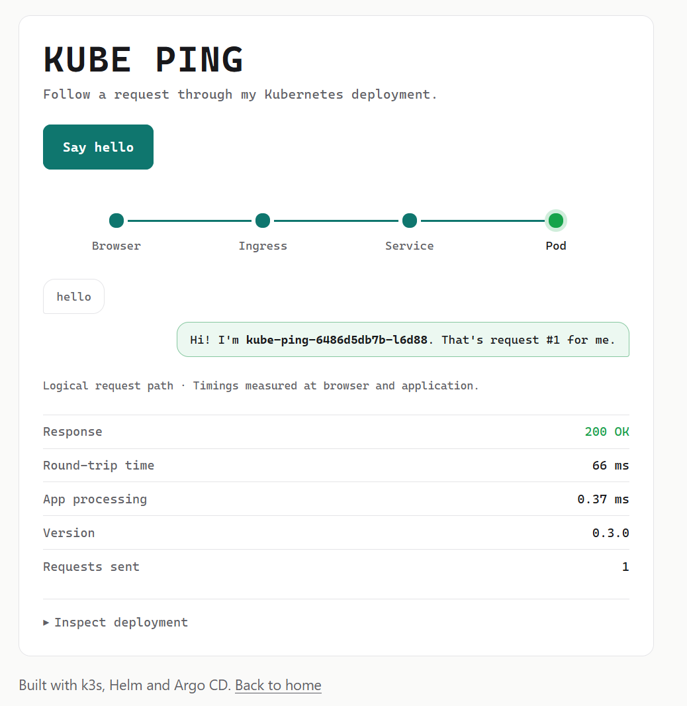

# kube-ping

The Kube Ping page and the API behind its card: a request goes through the Deployment and the card shows which pod answered.

One container serves both. The page is at `/kube-ping/` and `/es/kube-ping/`, the API at `/api/ping`.



## Endpoints

| Route | What it does |
|---|---|
| `GET /api/ping` | The pod that answered, the app version, its request count and processing time |
| `GET /api/ping/deployment` | The Deployment: replicas, pods, resources and probe paths |
| `GET /healthz` | Liveness |
| `GET /readyz` | Readiness: 503 while the pod shuts down |

## Run locally

```bash
kubectl proxy &
DEPLOYMENT_NAME=kube-ping POD_SELECTOR=app.kubernetes.io/name=kube-ping \
NAMESPACE=kube-ping-prod KUBE_API_URL=http://127.0.0.1:8001 npm start
```

## Test

```bash
npm test
```

## Release

Push a tag like `v0.3.0`. CI runs the tests and publishes `ghcr.io/<owner>/kube-ping:0.3.0`, with `0.3.0` as the version the card shows.
